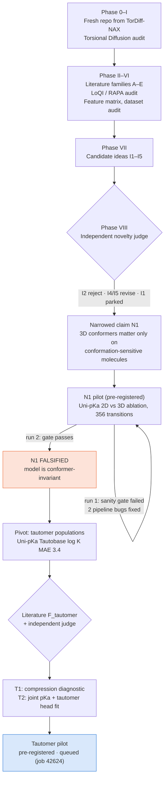
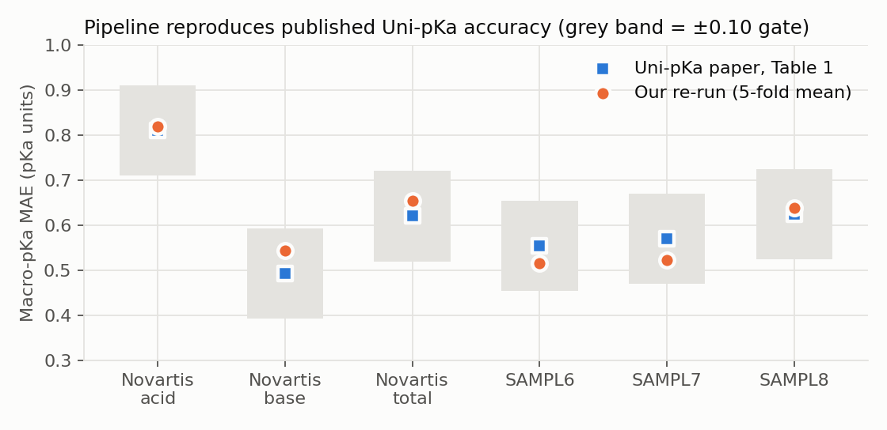
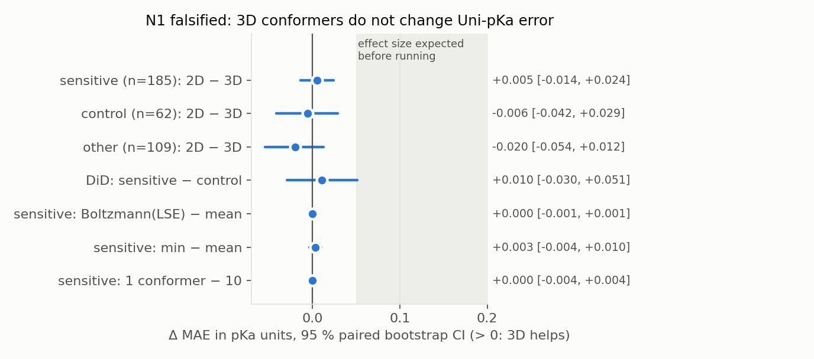
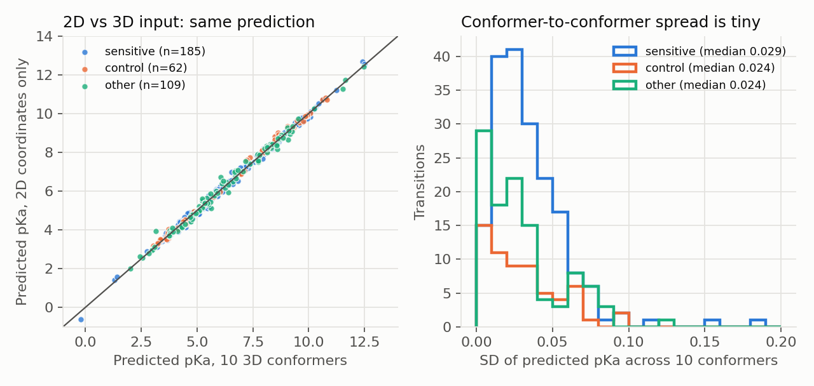

# Joint Microstate and Conformer Generation for pH-Dependent Molecular Modeling

Research programme asking whether a generative model can jointly learn **which chemical microstate** a molecule is in
(protonation/tautomer state `z`) and **which 3D conformer** it adopts (`x`, or torsions `τ`), conditioned on pH `h`:
`p(z, x | G, h)`. The second question is whether such a model beats sequential "pick a state, then generate conformers"
pipelines.

The starting point is a completed reproduction of Torsional Diffusion on GEOM-QM9 (see `prior_work/`). The project
follows a literature- and data-audited protocol:
- No novelty claim is made after a single search.
- Every experiment is pre-registered before any model output exists.
- Negative results are kept.

The evidence trail is in [`research/`](research/).

*Status as of 2026-10-27 11:20 UTC (16:50 IST).*

---

## At a glance

| What | Outcome |
|---|---|
| Torsional Diffusion baseline audit | Its torsion set depends on protonation state, so the joint problem is trans-dimensional |
| Literature | 243 logged search operations, 93 papers in the registry (31 read in full), 52 paper notes. Google Scholar was **not** available |
| Novelty loop, round 1 (5 ideas) | Full joint generator (I1) parked; I2 rejected; I3–I5 revised. These merged into one testable claim, **N1** |
| **N1 pilot**: do 3D conformers matter for pKa in Uni-pKa? | **Falsified** (pre-registered). The released Uni-pKa is effectively conformer-invariant |
| Novelty loop, round 2 (tautomers) | T1 (diagnostic) and T2 (joint pKa + tautomer fit) both "Revise", then narrowed |
| **Tautomer pilot (T1/T2)** | Pre-registered, approved, **queued** on gnode118 (job 42624) |
| Engineering findings | Bug: `unipkainfer` 0.2.0 generates 10 identical conformers. Our pipeline reproduces Uni-pKa's published accuracy |

## Research path



---

## Results so far

### 1. Baseline audit: the joint problem is trans-dimensional
Torsional Diffusion (upstream `5f713b4`) treats a bond as rotatable only if cutting it leaves a fragment with more than one atom
(`utils/torsion.py`). Adding or removing a proton therefore changes the **set** of torsions: COOH has a C–O(H) torsion,
COO⁻ does not. A joint model `p(z, τ | G, h)` must use per-state torsion sets or a heavy-atom torsion parameterisation
([`research/01_baseline_audit.md`](research/01_baseline_audit.md)).

### 2. Novelty loop: what already exists
- **LoQI** generates conformers for a given state only, with no pH input. **RAPA** enumerates protonation states with no generation and no pH.
- **AcepKa** (2026) already chains SMILES + pH → microstates → per-state conformers sequentially.
- **Uni-pKa**, **Starling** and **Rowan pKa** already feed 3D conformers into microstate free energies.
- So "joint generation" was parked. The judge's synthesis of the remaining ideas was a narrow, testable claim, N1
  ([`research/08_novelty_claims.csv`](research/08_novelty_claims.csv),
  [`research/architecture_candidates/N1_intent.md`](research/architecture_candidates/N1_intent.md)).

### 3. N1 pilot: do 3D conformers matter for pKa? → **No** (for Uni-pKa)
The claim tested: *"In a Uni-pKa-class model, 3D conformer input changes experimental pKa error only on conformationally
sensitive molecules."* We ran the released Uni-pKa (5 folds, SHA-verified weights, CPU) on its own external test sets:
SAMPL6/7/8 and Novartis, 356 transitions. Every arm comes from one forward pass:
- 2D coordinates only
- mean of 10 3D conformers
- Boltzmann (log-sum-exp) weighting
- minimum over conformers
- a single conformer

Molecules were split into *sensitive* (flexible intramolecular H-bond, salt bridge, close sites), *control* and *other*
strata before any model output existed ([PREREG](research/experiments/N1_pilot/PREREG.md)).

**Our pipeline reproduces the published accuracy** (needed before any conclusion):



**Main result: no effect anywhere.** All intervals include 0, and they exclude the 0.05–0.2 effect expected before running:



**Why:** the model's output barely moves with the conformer. 2D and 3D predictions lie on the diagonal, and the
conformer-to-conformer pKa spread has a median of about 0.03 units:



| Stratum | n | MAE, 3D (10 conformers) | MAE, 2D only | Δ (2D − 3D), 95 % CI |
|---|---|---|---|---|
| sensitive | 185 | 0.664 | 0.669 | +0.005 [−0.014, +0.024] |
| control | 62 | 0.557 | 0.551 | −0.006 [−0.042, +0.029] |
| other | 109 | 0.630 | 0.610 | −0.020 [−0.054, +0.012] |

The difference-in-differences (sensitive − control) is +0.010 [−0.030, +0.051]. **Verdict (pre-registered rule): N1 falsified.**

**Scope:** this shows that *this model* does not use geometry. It does not show that geometry is physically irrelevant to pKa.
Details: [`research/experiments/N1_pilot/run2/RESULTS.md`](research/experiments/N1_pilot/run2/RESULTS.md).

### 4. Things we found on the way (all logged, none hidden)
- **Run 1 failed its sanity gate** (MAE ≈ 6.4), so no conclusion was drawn from it. There were two causes:
  - The pKa conversion was missing Uni-pKa's normalisation mean (+6.505).
  - **`unipkainfer` 0.2.0 calls `EmbedMultipleConfs(randomSeed=0)`, which returns 10 identical conformers** (confirmed on
    RDKit 2024.03 and 2026.09). We replaced it with a verbatim port of the original Uni-pKa seed loop.
  - [`negative_results/N1_run1_pipeline_failure.md`](research/negative_results/N1_run1_pipeline_failure.md).
  - Upstream bug report: not filed yet (it is outward-facing and needs the owner's decision).
- **The paper's Conclusions mislabel its Table 1.** The quoted "Novartis 0.810" is the Novartis *acid* subset. Our gate first
  used the Conclusions numbers. It was corrected to Table 1 *after* seeing run-2 outputs; this is logged as a post-hoc amendment.
  The test itself was never touched.

### 5. Pivot: tautomer populations (in progress)
Uni-pKa's tautomer ratios are poor: the paper reports Tautobase log K MAE 3.435, and its authors note "similar free energies
to different tautomers". Its loss is a log-sum-exp over the microstates of a macrostate. That loss is invariant to moving free energy
*between* tautomers of the same macrostate, so macro-pKa data barely constrain tautomer ratios.

- **Closest prior work:** Zankov 2019 (conjugated QSPR for pKa + log K_T) and sPhysNet-Taut 2025 (tautomer-only, ≈ 0.85 log K).
- **T1 (diagnostic):** is Uni-pKa's tautomer error a *compression* of tautomer gaps, i.e. slope of predicted on measured log K well below 1?
- **T2 (method):** does fitting the free-energy head **jointly** on pKa and measured Tautobase ratios beat fitting it on tautomers alone,
  with no more than +0.05 pKa MAE?
- Design: 5-fold scaffold-grouped CV, 3 seeds, and five arms (released, pKa-only, tautomer-only, joint, joint + estimated labels).
  Thresholds are fixed in the [PREREG](research/experiments/T_pilot/PREREG.md).
- Expected before running: T1 holds (~75 %); T2 falsified (~55 %).
- **Status:** approved by the owner, submitted as job 42624, **queued** (gnode118 busy).

---

## Data built
- **Conformation-sensitivity strata (v2)** on the IUPAC pKa database (CC BY-NC) and Tautobase:
  - 6,395 pKa entries / 5,094 molecules.
  - Entries not in Uni-pKa's fine-tuning set: sensitive 2,229, control 678, other 1,542.
  - 221 measured aqueous Tautobase pairs.
  - Scaffold split 70/15/15.
  - See [`data_manifests/sensitive_set_v2/`](data_manifests/sensitive_set_v2/) and [`research/06_dataset_audit.md`](research/06_dataset_audit.md).

## Repository map
| Path | Contents |
|---|---|
| `research/00_project_state.md` | Phase-by-phase status |
| `research/02_*`, `03_*`, `scholar_runs/`, `paper_notes/` | Search logs, paper registry, per-family summaries, judge verdicts, paper notes |
| `research/07_candidate_ideas.md`, `08_novelty_claims.csv` | Ideas and their novelty decisions |
| `research/10_decision_log.md` | Every decision, timestamped (UTC) |
| `research/experiments/` | Pre-registrations, results, analysis JSON |
| `research/negative_results/` | Failed runs and falsified claims |
| `jmcg/data/` | Stratified dataset builder |
| `jmcg/experiments/` | N1 pilot (`n1_pilot.py`, `n1_analyze.py`); tautomer pilot (`taut_*.py`) |
| `jmcg/viz/make_readme_figs.py` | Regenerates the figures above from committed results |
| `slurm_jmcg/` | Slurm jobs (gnode118, `plafnet2`) |
| `prior_work/TORDIFF_NAX_HANDOFF.md` | Torsional Diffusion baseline handoff |

Baseline code, data and checkpoints stay frozen on gnode118 at `/scratch/nishanth.r/tordiff`.

## Limitations to keep in mind
- Google Scholar was never searched. ACS and ChemRxiv pages were often blocked (403), so 2025–26 preprint coverage is incomplete.
- Several key papers were read as abstracts only (e.g. Zankov 2019). Novelty statements say "not found in N queries", never "does not exist".
- The N1 sanity-gate references were corrected post hoc (logged).
- The N1 conclusion is about one model class (Uni-pKa).
- Everything so far ran on CPU. No new model has been trained yet.

Regenerate the figures (needs matplotlib):

```bash
python jmcg/viz/make_readme_figs.py .
```
